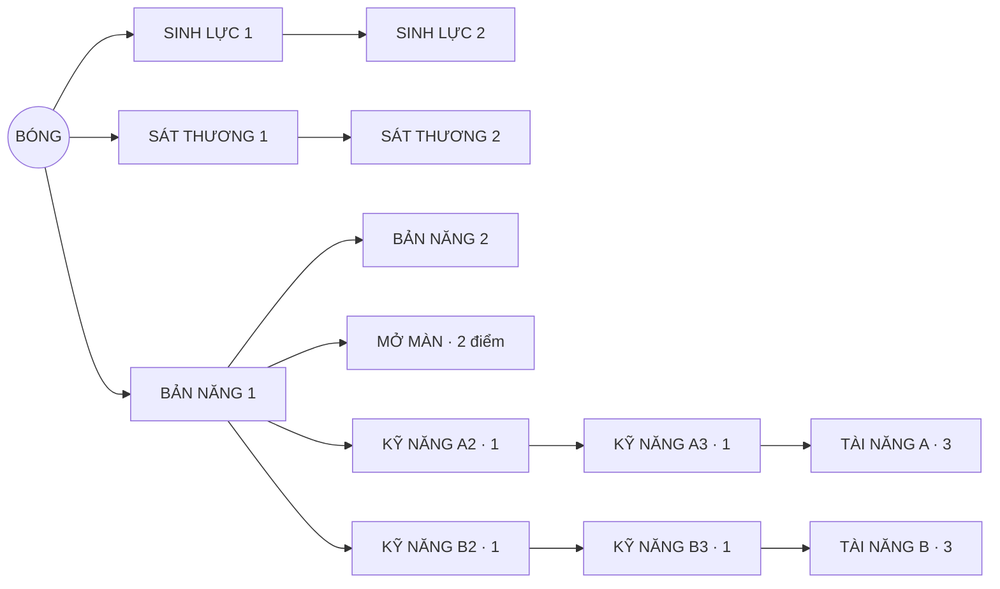

# BB-12 v2 — cây node cho tám bóng, lấy cảm hứng từ Persona Web của Identity V

**Trạng thái: note thiết kế, mới đo các node Sinh lực/Sát thương; các node riêng và build LV10 chưa được mô phỏng theo cơ chế v2.** Bản v1 đã bị loại qua 9.600 lượt Run LV10 trong [`bb12-tree-final-measurement.md`](bb12-tree-final-measurement.md): nhiều build vượt 70%, KEYSTONE A/B lệch đến 58 điểm thắng. V2 sửa cấu trúc và giảm sức mạnh dựa trên các phép đo đó. Không dùng kết quả node gốc để khẳng định cân bằng toàn cây.

## 1. Học từ Identity V, áp dụng có chọn lọc

Identity V gọi hệ thống nâng theo node là **Persona Web**. Bản cập nhật chính thức tháng 4/2023 cấp sẵn 120 Talent Points cho người chơi mới và cũ, bỏ yêu cầu tăng Persona Level qua trận để lấy điểm; khi chưa chọn, game có cấu hình tài năng mặc định. Bản cập nhật tháng 7/2025 tăng trần lên 130, thêm node vào các đường đã có, và mô tả nhiều talent kích hoạt theo điều kiện như thời gian truy đuổi, số sự kiện xảy ra hay trạng thái đồng đội. [Nguồn 2023](https://www.identityvgame.com/en/news/announcement/20230420/35288_1084054.html), [nguồn 2025](https://www.identityvgame.com/en/news/announcement/20250703/35288_1244746.html).

**Áp dụng cho Ball Battle:** nhìn được đường nối và node khóa; đủ điểm để tạo lối chơi riêng nhưng không mua hết; có build mặc định, hoàn điểm miễn phí và lưu preset; node cuối làm thay đổi cách chơi theo tình huống. **Không sao chép** số 130, talent hay cách kiếm điểm của Identity V. BB-12 vẫn dùng 1 điểm/cấp bóng LV1–10 theo quyết định của Phú; Versus/PvP vẫn độc lập với tiến trình vĩnh viễn.

## 2. Web chung và luật cộng điểm

- Tên nhóm node trong game: **Sinh lực**, **Sát thương**, **Bản năng**, **Mở màn**, **Kỹ năng** và **Tài năng**. Các mã VITALITY/POWER/GROWTH/START/SKILL/FINALE bên dưới chỉ để đối chiếu với prototype. Mỗi bậc Sinh lực, Sát thương, Bản năng tốn 1 điểm, tối đa 2 bậc/node. Mở màn tốn 2, Kỹ năng cấp 2/3 tốn 1 mỗi cấp, Tài năng tốn 3. Tổng có thể mua trên một đường là `6+2+2+3=13`; ngân sách LV10 là 10. Kỹ năng A/B và Tài năng A/B loại trừ nhau; Tài năng phải cùng nhánh kỹ năng.
- START và SKILL LV2 cần GROWTH 1 **và** ít nhất 2 điểm đã chi tầng gốc. SKILL LV3 cần LV2 cùng nhánh và ít nhất 5 điểm đã chi ở các node thấp hơn. FINALE cần LV3 cùng nhánh. Không có đường tắt mua FINALE ngay từ tầng gốc.
- LV1 có 3 lựa chọn đầu; LV9 là lần đầu có thể mua FINALE. Bộ kiểm topology `bb12/tree_builds_v2.py` đếm **18 build dùng đủ 10 điểm** ở LV10, trong đó 16 có FINALE. Đây là đếm cấu hình, không phải số liệu thắng. Điểm chưa chi giữ lại; hoàn điểm phải tự hoàn cả node phụ thuộc mất điều kiện.
- Màn BALLS có ít nhất 3 preset/bóng: **AN TOÀN**, **ĐỘT PHÁ**, **TỰ CHỈNH**. Preset chỉ là gợi ý, không cấp thêm điểm. Khi vào Run, lưu snapshot build; SWAP nạp preset của bóng mới. Bỏ SKILL UP khỏi card pool. Debug force-skill và save đang dở cần migration riêng. Versus/PvP không nhận điểm/cấp này.

### Sinh lực và Sát thương: cùng tên node, hệ số riêng theo bóng

Hệ số dưới đây **là mức thử khởi đầu v2** trên HP gốc / `DamagePct` Run, cộng tuyến tính theo rank, không nhân lũy tiến. Bản v1 dùng HP 4% và damage 6%/rank cho mọi bóng, khiến WRECKER thắng 80–91.5% trên sáu build LV10; LV1 SPORE/MIRROR lại yếu. Mỗi node có thể dùng coefficient riêng nhưng UI luôn hiển thị số thực của bóng được chọn.

| Bóng | Sinh lực mỗi bậc | Sát thương mỗi bậc | Lý do giới hạn |
|---|---:|---:|---|
| EMBER | +4% HP | +4% damage | Mức vừa, tăng trưởng từ hit đã mạnh. |
| MANTIS | +4% HP | +5% damage | Ưu tiên sát thương khi giữ combo. |
| ANGLER | +5% HP | +5% damage | Đầu trận yếu, cần sống đủ lâu để móc dài. |
| WRECKER | +1% HP | +1% damage | LV1 đã 54% trên holdout; sàng lọc 200 seed cho thấy +2/+2% vẫn đưa build gốc 4 điểm lên 66.5%. |
| SPARKLER | +4% HP | +4% damage | Đạn có thể nhân số lượng, tránh cộng quá mạnh. |
| SPORE | +5% HP | +6% damage | Giúp độc thực sự hưởng POWER; vẫn phải kiểm boss. |
| MIRROR | +5% HP | +6% damage | Reflect hưởng POWER; vẫn phải kiểm boss. |
| HIVE | +3% HP | +3% damage | Nhiều turret nhân hiệu quả của từng điểm damage. |

Không gắn thêm HP/damage tự động theo cấp, vì sẽ cộng sức mạnh ngoài web. Các hệ số riêng này **chưa sửa được** chênh LV1 hiện tại nếu người chơi giữ điểm chưa chi; cân bằng Run nền là một gate độc lập.

**Sàng lọc node gốc v2** (seed 901–1100, Greedy, 200 run/bóng, chỉ VITALITY 2 + POWER 2, không GROWTH/START/skill mới/FINALE): EMBER từ 27% baseline lên 41% với 4/4% mỗi rank; SPARKLER 31→46.5% với 4/4%; SPORE 18.5→39.5% với 5/6%; MIRROR 15→42.5% với 5/6%. WRECKER 54.5→66.5% ở 2/2%, nên v2 đã hạ tiếp còn **1/1%**: phép đo 54.5→60.5%. Đây chỉ là **pilot của bốn điểm gốc**, không xác nhận các node còn lại hay tỷ lệ LV10. CSV: `bb12/v2-root-baseline-200.csv`, `v2-root-h1-d1-200.csv`, `v2-root-h2-d2-200.csv`, `v2-root-h4-d4-200.csv`, `v2-root-h5-d6-200.csv`.

**Kiểm tra trên seed chưa dùng để chỉnh hệ số** (1101–1300, Greedy, 200 run/bóng): mỗi bóng dùng đúng hệ số trong bảng trên, mua 2 bậc Sinh lực + 2 bậc Sát thương. Cột gốc là cùng seed khi chưa mua node nào.

| Bóng | Gốc | Bốn điểm gốc | Tăng |
|---|---:|---:|---:|
| EMBER | 26% | 46% | +20 điểm % |
| MANTIS | 26,5% | 45,5% | +19 điểm % |
| ANGLER | 25,5% | 47% | +21,5 điểm % |
| WRECKER | 58% | 62% | +4 điểm % |
| SPARKLER | 28,5% | 47,5% | +19 điểm % |
| SPORE | 18% | 42,5% | +24,5 điểm % |
| MIRROR | 19,5% | 41,5% | +22 điểm % |
| HIVE | 39% | 56% | +17 điểm % |

**Đọc kết quả:** hệ số giảm đã giữ cả tám build bốn điểm dưới 70%, nhưng khoảng cách WRECKER–MIRROR vẫn **20,5 điểm phần trăm**. Chênh nền khi chưa mua node là 40 điểm. Như vậy việc giảm hệ số WRECKER không đủ để cân bằng tám bóng; cần chỉnh Run nền và thử toàn cây trước khi chốt. Mẫu 200 seed chỉ là sàng lọc, chưa đạt gate 500 seed/build. Dữ liệu gốc: `bb12/v2-holdout-*-200.csv` (cùng seed, gồm cả các profile hệ số để đối chiếu).

## 3. Node mang bản sắc từng bóng

### Cách đặt tên

So với bản tiếng Anh, LoL Việt dùng **cách nói hợp nhân vật**, không áp một công thức đặt tên cho mọi chiêu. *Short Fuse* của Ziggs thành **Dễ Nổi Điên** (chọn nghĩa bóng quen thuộc); *Move Quick* của Teemo thành **Chạy Lẹ** (khẩu ngữ ngắn); *Zoomies* của Yuumi thành **Tăng Động** (tinh nghịch); *Switcheroo!* của Jinx thành **Tráo Hàng!** (giữ giọng quậy phá). Cùng một game vẫn có tên nghiêm túc như **Mưa Tên Lửa** của Rumble. Đối chiếu: [Ziggs EN](https://www.leagueoflegends.com/en-us/champions/ziggs/) / [VI](https://www.leagueoflegends.com/vi-vn/champions/ziggs/), [Teemo EN](https://www.leagueoflegends.com/en-us/champions/teemo/) / [VI](https://www.leagueoflegends.com/vi-vn/champions/teemo/), [Yuumi EN](https://www.leagueoflegends.com/en-us/champions/yuumi/) / [VI](https://www.leagueoflegends.com/vi-vn/champions/yuumi/), [Jinx EN](https://www.leagueoflegends.com/en-us/champions/jinx/) / [VI](https://www.leagueoflegends.com/vi-vn/champions/jinx/), [Rumble VI](https://www.leagueoflegends.com/vi-vn/champions/rumble/).

Áp dụng cho Ball Battle: tên node là **tên chiêu**, không phải câu diễn giải thông số. Dùng từ/cụm từ người Việt thật sự nói; giữ hình tượng của từng bóng; chỉ thêm khẩu ngữ, thành ngữ hoặc dấu cảm khi hợp tính cách. Tránh ép cặp A/B phải đối vần, lặp “càng… càng…” ở nhiều bóng, hoặc biến mọi tên thành một câu đùa. Tooltip bên dưới chịu trách nhiệm giải thích chính xác hiệu ứng. Đây là tên mới cho Ball Battle, không lấy tên chiêu của LoL.

Tên hiển thị đề xuất, đọc theo thứ tự **Bản năng → Mở màn → Tài năng A / B**:

| Bóng | Bản năng | Mở màn | Tài năng A | Tài năng B |
|---|---|---|---|---|
| EMBER | Bén lửa | Than hồng | Lửa chưa tàn | Phủ đầu |
| MANTIS | Quán tính | Vào guồng | Chưa hạ nhiệt | Máu chiến |
| ANGLER | Nới dây | Thả câu | Quăng xa | Giật cần |
| WRECKER | Húc lấy húc để | Lấy đà | Biết lượng sức | Lao không phanh |
| SPARKLER | Châm ngòi | Khai pháo | Dồn lực | Mưa pháo |
| SPORE | Độc ngấm | Gieo mầm độc | Phát tác | Dai dẳng |
| MIRROR | Gương hộ thân | Dựng khiên | Kính chống đạn | Ăn miếng trả miếng |
| HIVE | Lên dây cót | Quân dự bị | Trọng pháo | Mưa đạn |

Mọi hiệu ứng ghi dưới đây chỉ áp dụng trong Run của bóng đó. Các số là **tham số v2 để thử**, không phải trị số đã qua gate. GROWTH/START nhỏ hơn v1 theo độ nhạy đã đo; FINALE ưu tiên đổi nhịp/tầm/tình huống thay vì nhân damage và HP thường trực. `Skill A/B` ở giữa web dùng đúng tên nhánh hiện tại. Các tên tiếng Anh cạnh tên bóng trong bảng thông số là mã nhánh kỹ thuật của game, không phải nhãn tiếng Việt đề xuất.

| Bóng / nhánh kỹ năng | Bản năng mỗi bậc | Mở màn · 2 điểm | Tài năng A · 3 điểm | Tài năng B · 3 điểm |
|---|---|---|---|---|
| **EMBER** EDGE / HONE | **Bén lửa:** mỗi đòn đánh trúng giúp tăng thêm 2% sát thương gốc mỗi bậc (v1: 5%). | **Than hồng:** sát thương lúc bắt đầu trận tăng 0,2 (v1: 0,5 sau giảm). | **Lửa chưa tàn:** sau khi bị chặn đòn, đòn đánh trúng kế tiếp được cộng thêm 0,5 sát thương từ cơ chế tăng trưởng; tối đa một lần mỗi 6 giây. | **Phủ đầu:** hai đòn đánh trúng đầu trận gây thêm 0,25 sát thương mỗi đòn; từ đòn thứ ba, mức tăng sát thương sau mỗi đòn giảm 5%. |
| **MANTIS** ENDURE / FURY | **Quán tính:** tỷ lệ giữ lực xoáy `SpinGain` sau mỗi đòn trúng tăng từ 0,92 lên 0,93/0,94; trần lực xoáy không đổi. | **Vào guồng:** đòn trúng đầu tiên cho thêm 2 lực xoáy; không tăng lực xoáy sẵn có lúc bắt đầu trận. | **Chưa hạ nhiệt:** trong 2 giây sau khi Cuồng Kích (`FRENZY`) kết thúc, mỗi đòn trúng nhận thêm 50% lực xoáy từ `SpinGain`; hồi sau 12 giây. | **Máu chiến:** đòn trúng đầu tiên trong Cuồng Kích gây thêm 10% sát thương; phải chờ 3 giây mới có thể nhận lại hiệu ứng này. |
| **ANGLER** REACH / HOLD | **Nới dây:** mức tăng độ dài dây móc sau mỗi đòn trúng (`PikeGrowthPerHit`) tăng thêm 2% giá trị gốc mỗi bậc (v1: 4%). | **Thả câu:** dây móc lúc bắt đầu trận dài thêm 1 đơn vị (v1: thêm 3 đơn vị đã tăng tỷ lệ thắng 19 điểm phần trăm trên 200 seed). | **Quăng xa:** khi Lao Tới (`LUNGE`), dây móc dài hơn 8% nhưng sát thương giảm 8%; ngoài trạng thái này không đổi. | **Giật cần:** khi Lao Tới, dây móc ngắn hơn 8% nhưng sát thương tăng 8%; ngoài trạng thái này không đổi. |
| **WRECKER** SLAM / RUSH | **Húc lấy húc để:** mức tăng sát thương theo tốc độ sau mỗi đòn trúng (`BrawlerDamagePerSpeedPerHit`) tăng thêm 2% giá trị gốc mỗi bậc (v1: 5%). | **Lấy đà:** hệ số sát thương `DamageFactor` lúc bắt đầu trận tăng 0,002; không tăng giới hạn tốc độ. | **Biết lượng sức:** giảm 15% sát thương nhận từ tường gai, đổi lại mức tăng tốc khi bật tường giảm 15%. | **Lao không phanh:** mức tăng tốc khi bật tường tăng 15%, đổi lại sát thương nhận từ tường gai tăng 15%; không tăng `DamageFactor`. |
| **SPARKLER** RAPID / HEAVY | **Châm ngòi:** sau mỗi đòn cận chiến trúng, sát thương của từng mũi tên tăng thêm 0,01 mỗi bậc (v1: 0,025). | **Khai pháo:** chỉ loạt bắn đầu trận có thêm một mũi tên gây 50% sát thương; các loạt sau giữ nguyên. | **Dồn lực:** mỗi loạt bắn bớt một mũi tên, tối thiểu còn một; tổng sát thương cũ được chia đều cho số tên còn lại. | **Mưa pháo:** mỗi loạt bắn thêm một mũi tên, tối đa chín; tổng sát thương cũ được chia đều cho số tên mới. Hai nhánh đổi số đạn và cách đối thủ chặn đòn, không tự tăng tổng sát thương. |
| **SPORE** SIP / ROT | **Độc ngấm:** sát thương độc mỗi giây tăng thêm 3% giá trị gốc mỗi bậc (v1: 8%). | **Gieo mầm độc:** trong hai đòn trúng đầu trận, mỗi đòn có thể gây thêm một tầng độc nếu chưa đạt giới hạn; sát thương độc mỗi giây không đổi. | **Phát tác:** sát thương độc mỗi giây tăng 10%, thời gian nhiễm độc chia 1,10; tổng sát thương mỗi tầng gần như giữ nguyên. | **Dai dẳng:** sát thương độc mỗi giây giảm 10%, thời gian nhiễm độc chia 0,90; tổng sát thương mỗi tầng gần như giữ nguyên. |
| **MIRROR** WALL / SPITE | **Gương hộ thân:** mức tăng độ rộng khiên sau mỗi đòn trúng cao hơn 5% giá trị gốc mỗi bậc (v1: 20%). | **Dựng khiên:** khiên lúc bắt đầu trận rộng thêm 0,25 đơn vị (v1: 0,5 đã tăng tỷ lệ thắng 7,5 điểm phần trăm trên 200 seed). | **Kính chống đạn:** tỷ lệ hấp thụ đạn tăng 5 điểm phần trăm, đổi lại sát thương phản lại giảm 5%; độ rộng khiên không đổi. | **Ăn miếng trả miếng:** sát thương phản lại tăng 10%, đổi lại tỷ lệ hấp thụ đạn giảm 5 điểm phần trăm; độ rộng khiên không đổi. |
| **HIVE** BURST / DEPLOY | **Lên dây cót:** mỗi bậc rút ngắn chu kỳ bắn của trụ đi một nhịp mô phỏng (v1: hai nhịp). | **Quân dự bị:** có sẵn một trụ lúc bắt đầu trận; trụ này biến mất sau loạt bắn đầu tiên. | **Trọng pháo:** chu kỳ bắn và sát thương mỗi viên đạn đều nhân 1,10; ít loạt hơn nhưng mỗi viên mạnh hơn. | **Mưa đạn:** chu kỳ bắn và sát thương mỗi viên đạn đều nhân 0,90; nhiều loạt hơn nhưng mỗi viên yếu hơn. |

**Các node cần code mới:** EMBER on-parry trigger, MANTIS FRENZY-end timer, WRECKER spike damage riêng, SPARKLER chia ngân sách damage theo số arrow, SPORE hai hit đầu, MIRROR tách projectile absorb, HIVE turret tạm. Các node này đang được thử trong `bb12/harness-v2`, tách khỏi Sim chính. Không đưa trị số vào Sim chính trước khi đo.

## 4. Vì sao v2 có cơ hội cân bằng hơn v1

1. **Trần cộng dồn thấp hơn:** V/P của WRECKER từ 4/6% xuống 1/1% mỗi rank sau sàng lọc; GROWTH của EMBER/ANGLER/WRECKER/SPARKLER/SPORE/MIRROR/HIVE đều giảm. Các node v1 từng cho +15–27.5 điểm thắng chỉ với hai rank.
2. **Nhánh cuối gắn với đường đi:** FINALE A cần skill A3, FINALE B cần B3. Không còn phối hợp nhánh không rõ chủ đề; tốn 3 điểm nên mất cơ hội mua V/P/START.
3. **Tổng sức mạnh có rào:** SPARKLER phân lại cùng ngân sách damage, SPORE giữ gần bằng damage tích phân, HIVE giữ gần bằng DPS; ANGLER chỉ đổi length/damage khi LUNGE; WRECKER có lợi ở một arena nhưng trả giá ở cùng cơ chế. Đó là thiết kế giảm nguy cơ nhánh A thắng mọi trận, **không phải bằng chứng cân bằng**.
4. **Node hướng vào điểm yếu có chủ đích:** EMBER bị parry mất đà; ANGLER yếu đầu trận và ở sân hẹp; SPORE/MIRROR thua boss; HIVE chậm dựng tổ. V2 giữ những nét từ [`weapon-bible.md`](weapon-bible.md), không xóa counter tự nhiên của từng bóng.

## 5. Gate đo trước khi chốt

- Đo **LV1 không cây**, mỗi node riêng, các build LV4/LV7, **toàn bộ 18 build LV10** cho tám bóng bằng cùng seed. Ít nhất 500 seed/bóng/build cho vòng cuối và một dải seed holdout chưa dùng để tune. Dùng cả Greedy và một policy bot khác; giữ CSV win/fights, boss MIMIC/WARDEN, arena, đối thủ và thời gian fight.
- Gate thiết kế: tỷ lệ Run thắng LV10 của build mạnh nhất ≤70% ở HEAT 0; chênh trong cùng bóng giữa hai FINALE cùng ngân sách ≤8 điểm trên 500 seed; chênh giữa các bóng ở build tốt nhất ≤15 điểm; node 2 điểm phải có giá trị rõ so với hai rank gốc; LV10 không yếu hơn LV1 cùng bóng.
- Gate nền: SPORE, MIRROR, EMBER, MANTIS và ANGLER đang dưới 25% LV1 trên holdout cũ; WRECKER 54%. Nếu mục tiêu LV1 ≥25% vẫn giữ, phải làm pass **Run-only** ở baseline trước khi có thể tuyên bố tám cây cân bằng. Kết quả v1 đã chỉ ra SPORE/MIRROR mất chủ yếu ở boss; hãy sửa đường boss/trait interaction có kiểm soát, không buff Versus mù quáng.
- Nếu gate thất bại sau một vòng tune v2, đổi cơ chế node gây trội/hại thay vì chỉ tăng số. Khóa build đã lưu, xác nhận SWAP, save migration và PvP normalization trước khi triển khai chính thức.
